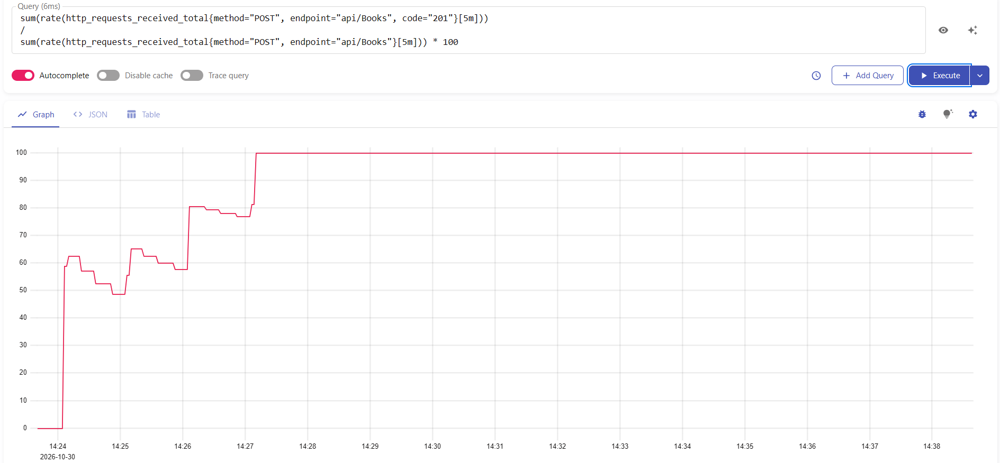
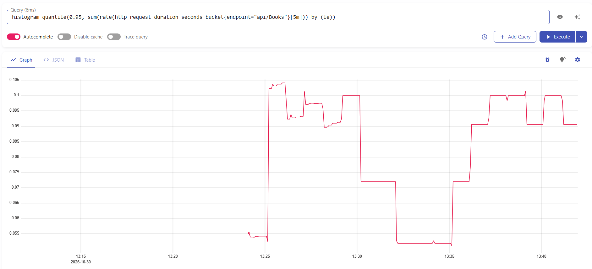
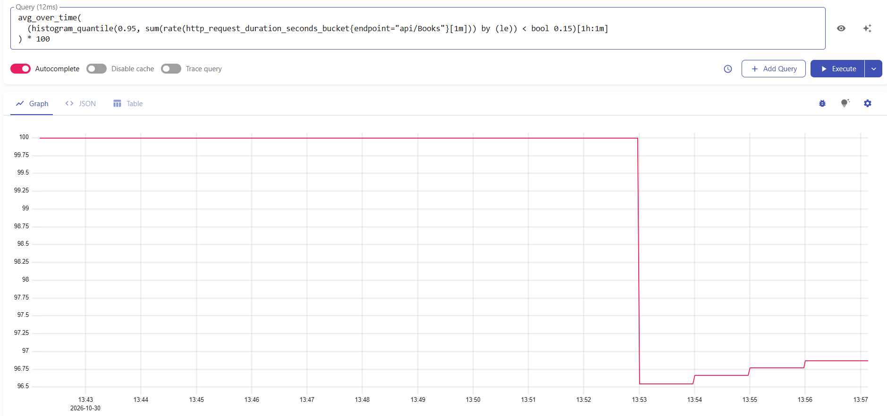
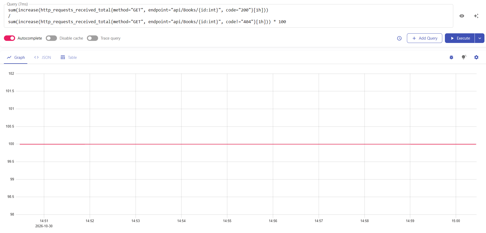
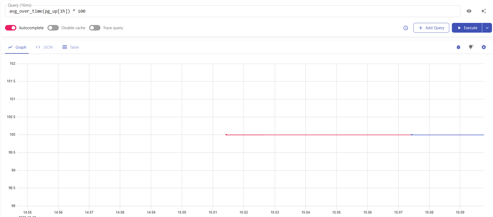

# Каталог прочитанных книг с отзывом CatalogProject
Клиент-серверное приложение

## Доменная область приложения
Пользователи  
Книги  
Пользователь может оставить отзыв и внести данные о прочитанной или планируемой к прочтению книге

## Стек реализации
Язык программирования C#  
Фреймворки .NET и EF  
СУБД PostgreSQL
Фронтенд Vite + Vanilla JS

## Основные сущности доменной области приложения
User  
Book

## Переменные окружения
### В основной директории
POSTGRES_DB=
POSTGRES_USER=
POSTGRES_PASSWORD=
CORS_ALLOWED_ORIGINS= (перечислить через запятую)
### Frontend (client/.env)
VITE_API_URL=  
VITE_PLACEHOLDER_IMAGE=

## API Endpoints
| Метод | URL | Описание |
|-------|-----|----------|
| GET | /api/books | Список книг |
| GET | /api/books/{id} | Одна книга |
| POST | /api/books | Создать |
| PUT | /api/books/{id} | Обновить |
| DELETE | /api/books/{id} | Удалить |

## Аргументация соответствия каждому из пунктов методологии 12 факторов, либо обоснование, почему приложение не может соответствовать этому пункту
### 1. Кодовая база
Используется Git и один репозиторий на приложение
### 2. Зависимости
Манифест зависимостей в CatalogProject.csproj с указанием версий
### 3. Конфигурация
Секреты (строка подключения) хранятся в .env и не попадают в Git (.env в .gitignore).  
Не секретные настройки (уровень логирования, окружение) — в appsettings.json / appsettings.Development.json.  
На фронтенде конфигурация — в client/.env (VITE_API_URL, VITE_PLACEHOLDER_IMAGE).  
### 4. Сторонние сервисы
PostgreSQL подключается через Npgsql по строке подключения из env.
Замена СУБД возможна сменой провайдера EF Core (например, на SQL Server) без изменения бизнес-логики.
### 5. Сборка, релиз, запуск
Сборка: dotnet build → артефакт в bin/.  
Релиз: конфигурация подаётся через .env при запуске.  
Запуск: dotnet run (dev) или dotnet CatalogProject.dll (prod).  
Стадии разделены: код не меняется между сборкой и запуском.  
### 6. Процессы
Приложение не хранит состояние в памяти: данные — в PostgreSQL, сессии отсутствуют.  
Процесс можно перезапустить без потери данных.  
Возможен запуск нескольких экземпляров (stateless).  
### 7. Привязка портов
Приложение само является http-сервером, так как .net проект - self-contained, dotnet run поднимает Kestrel, который слушает порт.    
На фронтенде используется Vite - тоже self-contained http-сервер, который сам поднимается на порту  
Порт бэкенда указывается в .env, а для фонтенда в vite.config.js (этот подходя является безопасным, потому что этот файл относится к Node.js-среде (серверной части сборки), а не к коду, который уходит в браузер)
### 8. Параллелизм
Backend stateless, можно запустить несколько экземпляров за балансировщиком, Frontend статика, раздаётся Vite  
Фоновых задач и очередей нет, поэтому race conditions отсутствуют.
### 9. Утилизируемость
Запуск осуществляется быстро, сборка около 10 секунд, запросы к бд через ef выполняются за 50-60 мс  
Данные при падении и перезапуске не теряются  
Процесс корректно завершается по SIGINT/SIGTERM (стандартное поведение Kestrel)
### 10. Паритет разработки и продакшена
Есть разделение appsettings.Development.json (dev) и appsettings.json (prod-шаблон), деплой возможен из докер файла и будет реализован в следующем задании  
Разделение через ASPNETCORE_ENVIRONMENT: Development / Production
### 11. Логирование
К методам контроллера добавлено логирование в stdout  
Уровни логирования настраиваются через appsettings.json
### 12. Административные задачи
Миграции EF Core запускаются отдельной командой: dotnet ef database update.  
Скрипты миграций генерируются командой dotnet ef migrations add <название>.  
Админ-задачи не выполняются автоматически при старте приложения.  

# Развертывание в Kubernetes
## 1. Абстракции
### Deployment
Для stateless-компонентов: catalogbackend и catalogfrontend  
Управляет жизненным циклом подов, обеспечивает заданное число реплик
### StatefulSet
Для postgres  
Даёт стабильное имя пода (postgres-0) и постоянное хранилище
### Service
postgres  
catalogbackend ClusterIP, доступен внутри кластера по имени catalogbackend:8080  
catalogfrontend NodePort, открывает фронт наружу (minikube service catalogfrontend)  
### Job
Для одноразовой задачи catalog-migrator, применение миграций
### ConfigMap
Не секретные настройки и SQL-скрипт миграций catalog-migrations
### Secret
Секретные данные
### PersistentVolumeClaim
Создаётся автоматически через volumeClaimTemplates StatefulSet, хранит данные PostgreSQL (1Gi)

## 2. Взаимодействие сервисов
Приложение состоит из четырёх компонентов: catalogfrontend, catalogbackend, postgres и catalog-migrator.  
  
**catalogfrontend** доступен пользователю через Service типа NodePort, который пробрасывает порт 80 контейнера nginx на порт ноды. Это единственный компонент, открытый наружу. Запросы к API фронтенд выполняет на относительный путь /api/..., а nginx внутри пода проксирует их на http://catalogbackend:8080 через ClusterIP Service. 

**catalogbackend** обращается к базе данных по строке подключения, полученной из Secret catalog-secrets. Имя postgres резолвится через headless Service (clusterIP: None), который связан со StatefulSet PostgreSQL. Service балансирует входящие запросы между репликами бэкенда.  

**postgres** запущен в единственном экземпляре как StatefulSet с постоянным хранилищем. Он не выставлен наружу и доступен только внутри кластера.  

**catalog-migrator** одноразовый Job, применяющий SQL-миграции к базе данных. Взаимодействие с БД построено в два этапа: init-контейнер ожидает готовности PostgreSQL через pg_isready -h postgres, после чего основной контейнер выполняет psql с миграционным скриптом, смонтированным из ConfigMap.  

## Использование migrate.sql
Файл migrate.sql содержит идемпотентный SQL-скрипт миграций EF Core, сгенерированный командой dotnet ef migrations script --idempotent. Он передаётся в кластер через ConfigMap catalog-migrations и монтируется в Job catalog-migrator как volume, откуда его читает psql.  
Для создания ConfigMap используется команда:
kubectl create configmap catalog-migrations --from-file=migrate.sql --dry-run=client -o yaml | kubectl apply -f -  
**Причина такого подхода:** образ мигратора я намеренно сделала облегчённым, в нём нет .NET SDK и dotnet ef, за счёт чего размер образа уменьшен примерно с 1 ГБ до 200 МБ. Поскольку dotnet ef в контейнере недоступен, я генерирую миграции заранее и применяю их. SDK нужен только на этапе разработки и сборки, а в runtime-образе он избыточен и мне нужно было поэкономить память)))

# Метрики
*   **VictoriaMetrics (Single-node)** + встроенный скрейпер для сбора метрик
*   **Prometheus-net**  библиотека .NET сбора метрик рантайма и HTTP-запросов (`prometheus-net.AspNetCore` и `prometheus-net.SystemMetrics`)
*   **postgres-exporter** экспортер метрик PostgreSQL от Prometheus (добавлен как контейнер к поду Postgres)

Для мониторинга бизнес-логики приложения реализован класс BookMetrics с использованием кастомных метрик Prometheus
1. Текущее количество опубликованных книг(Gauge)  
2. Количество просмотров книг (с разбивкой по жанрам)(Counter)  
3. Количество запросов всего списка книг(Counter)  
4. Количество NotFound книг(Counter)  

# SLI/SLO/SLA
**Выбор метрик для SLI:**  
* Критичными сценариями могут выступать:
  1. добавление книги в каталог
  2. просмотр всех книг
  3. просмотр книги
* Критичные сервисы, участвующие в сценарии: бэкенд и бд
* Таким образом, для SLI выберем такой набор параметров:
  1. Доля успешно добавленных книг
  2. Время ответа для получения списка книг
  3. Доля успешных просмотров книг от общего числа запросов на просмотр
  4. Доступность бд
  
**Доля успешно добавленных книг**  
По метрике http_requests_received_total  
Фильтры (лейблы): method="POST", endpoint="/api/books"  
`sum(increase(http_requests_received_total{method="POST", endpoint="api/Books", code="201"}[1h]))
/
sum(increase(http_requests_received_total{method="POST", endpoint="api/Books"}[1h])) * 100 `  
SLI (Request-Based): Доля успешных POST-запросов от общего числа попыток добавления книги за последний час  
SLO: 99.9%   
SLA: 99%  
Сначала был дефект, так как пробер отправлял POST-запросы не со всеми обязательными полями, поэтому были ошибки 400 Bad Request. Как видно на графике, SLI в этот момент был 0%. После исправления формата приложение начало возвращать 201 Created, график SLI начал расти и достиг целевого значения 100%

  
  
**Время ответа для получения списка книг**
По метрике http_request_duration_seconds_bucket  
Фильтры: endpoint="/api/books"  
Формула `histogram_quantile(0.95, sum(rate(http_request_duration_seconds_bucket{endpoint="api/Books"}[5m])) by (le))`  
Судя по графику 95% запросов на получение списка книг выполняются быстрее 100 мс 
SLI: Доля минут (Time-Based) за последний час, в течение которых 95% запросов выполняются быстрее 150 мс  
SLO: цель, чтобы 98% времени p95 Latency для /api/books был ниже 150 мс    

  
SLA: Если этот показатель падает ниже 96%, это нарушение SLA  
`avg_over_time(
(histogram_quantile(0.95, sum(rate(http_request_duration_seconds_bucket{endpoint="api/Books"}[1m])) by (le)) < bool 0.15)[1h:1m]
) * 100`

  
  
**Доля успешных просмотров книг**  
По метрике microsoft_aspnetcore_hosting_http_server_request_duration_count 
Фильтры: method="GET", endpoint="api/Books/{id:int}", status_code="200"
`(sum(increase(microsoft_aspnetcore_hosting_http_server_request_duration_count{http_route="api/Books/{id:int}", http_response_status_code="200"}[1h])) 
  / sum(increase(microsoft_aspnetcore_hosting_http_server_request_duration_count{http_route="api/Books/{id:int}", http_response_status_code!="404"}[1h]))) * 100`  
SLI (Request-Based): Доля успешных GET-запросов от общего числа попыток просмотра книги (исключая клиентские ошибки 404)  
SLO: 99%  
SLA: 96%  

 
   
**Доступность бд**  
По pg_up  
SLI: Доля минут (Time-Based) за последний час, в течение которых база данных была доступна  
SLO: Цель — 99.9% времени база данных должна быть доступна  
SLA: Если этот показатель падает ниже 99.5%, это нарушение SLA  
`avg_over_time(max(pg_up) by (app)) * 100`  
Агрегируем метрику pg_up с помощью функции max by (app), чтобы избежать появления дублирующихся линий и корректно считать доступность сервиса, а не отдельных экземпляров подов  

  
